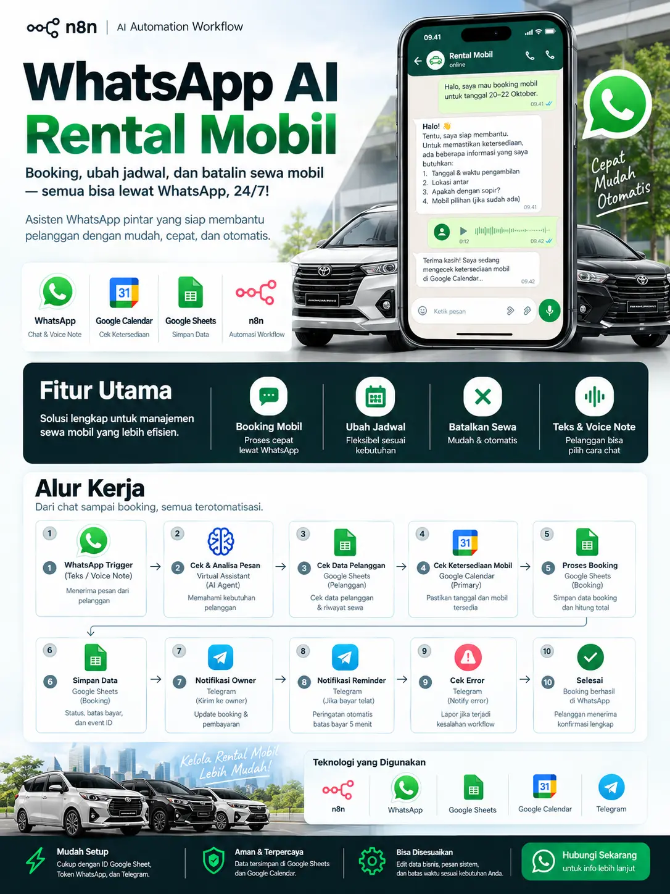
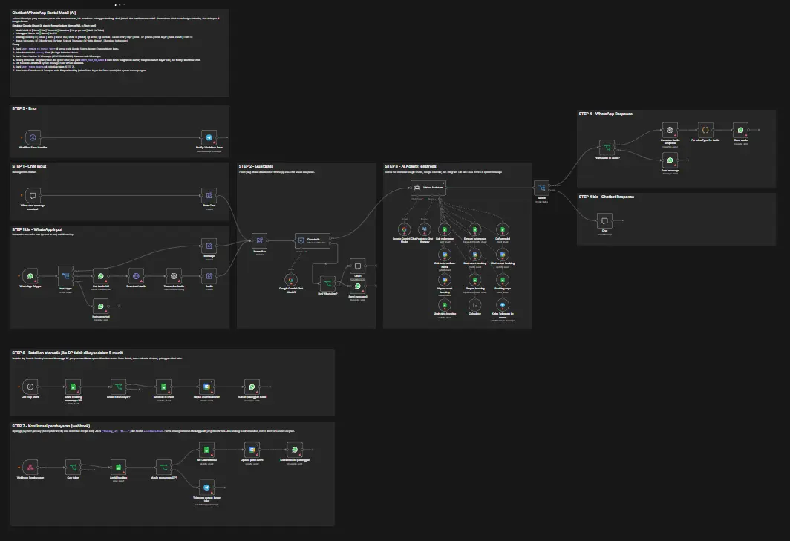
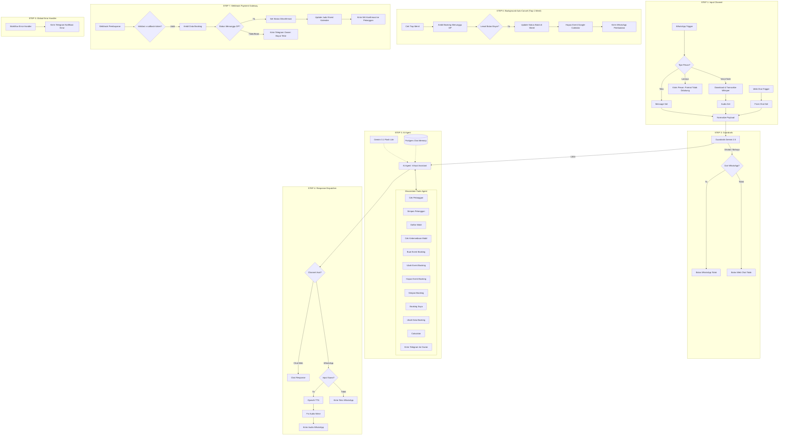

# 🚗 WhatsApp AI Rental Mobil - Booking Assistant

Workflow otomatisasi berbasis **n8n** dan **AI Agent (LangChain)** untuk operasional rental mobil 24/7 melalui WhatsApp. Sistem ini mampu menangani pemesanan mobil baru (*booking*), pengecekan ketersediaan jadwal, perubahan jadwal (*reschedule*), pembatalan, kalkulasi DP & total biaya, hingga auto-cancellation dan integrasi webhook pembayaran.



---

## 📌 Ringkasan Proyek

| Komponen | Spesifikasi & Teknologi |
| :--- | :--- |
| **Workflow Engine** | [n8n](https://n8n.io/) (Self-hosted / Cloud) |
| **Framework AI** | `@n8n/n8n-nodes-langchain` (AI Agent, Guardrails, Tools, Memory) |
| **Model LLM Utama** | Google Gemini (`models/gemini-3.1-flash-lite-preview`) |
| **Model Guardrails** | Google Gemini (`models/gemini-2.5-flash-lite`) |
| **Voice Processing** | OpenAI Whisper (`transcribe`) & OpenAI Audio (`tts-1` / voice: `onyx`) |
| **Conversational Memory** | PostgreSQL Chat Memory (Context window: 15 interaksi) |
| **Database & Kalender** | Google Sheets (4 Sheet) & Google Calendar (`primary`) |
| **Saluran Komunikasi** | WhatsApp Cloud API (Teks & Voice Note) & Web Chat Trigger |
| **Notifikasi Owner** | Telegram Bot API |
| **Integrasi Pembayaran** | Webhook JSON Callback (Xendit / Midtrans / Duitku / dll) |

---

## 🗺️ Gambaran Canvas Workflow n8n

Berikut tampilan keseluruhan node dan arsitektur alur kerja di dalam n8n canvas:



---

## 🌟 Fitur Unggulan

1. **Multi-Modal Input (Teks & Voice Note WhatsApp)**
   - Pelanggan dapat berinteraksi menggunakan pesan teks biasa maupun rekaman suara (*voice note*).
   - Voice note secara otomatis diunduh dan ditranskripsi ke teks bahasa Indonesia menggunakan OpenAI Whisper.
   - Apabila pelanggan bertanya lewat voice note, asisten secara cerdas dapat membalas kembali dalam bentuk pesan suara (*audio response* sintetis menggunakan OpenAI TTS).

2. **AI Booking Assistant Cerdas ("Testarosa")**
   - Dilengkapi *System Persona* ramah, singkat, dan terstruktur sesuai gaya obrolan WhatsApp.
   - Pengecekan ketersediaan mobil langsung ke Google Calendar secara real-time (*anti double-booking*).
   - Perhitungan durasi sewa, batas toleransi overtime, biaya driver, dan nominal DP 30% menggunakan sub-node `Calculator` agar bebas halusinasi hitungan.

3. **Self-Service Reschedule & Pembatalan**
   - Pelanggan dapat mengubah jadwal atau membatalkan pesanan cukup melalui chat.
   - Jadwal pada Google Calendar dan status pada Google Sheets diperbarui secara otomatis.

4. **Lapisan Keamanan (AI Guardrails)**
   - Menyaring upaya *jailbreak*, *prompt injection*, atau pesan di luar konteks bisnis sebelum masuk ke agent utama.

5. **Auto-Cancellation DP Kedaluwarsa (Cron Job)**
   - Background trigger yang berjalan setiap 1 menit untuk memeriksa pesanan yang belum dibayar dalam batas waktu (5 menit sejak booking dibuat).
   - Jika melewati batas epoch, status diubah menjadi `Dibatalkan (DP tidak dibayar)`, event kalender dihapus, dan pelanggan dikabari via WhatsApp.

6. **Webhook Konfirmasi Pembayaran Otomatis**
   - Menerima notifikasi instan dari Payment Gateway melalui REST Webhook dengan verifikasi token header `x-callback-token`.
   - Mengubah status pesanan menjadi `Dikonfirmasi` dan memperbarui nama event pada Google Calendar.
   - Jika pembayaran masuk untuk booking yang telah dibatalkan otomatis, sistem langsung melapor ke owner via Telegram.

7. **Sistem Notifikasi & Error Monitoring**
   - Pemilik (*owner*) mendapatkan notifikasi Telegram setiap ada booking baru, perubahan jadwal, konfirmasi transfer, atau pertanyaan di luar wewenang AI.
   - Dilengkapi node `Workflow Error Handler` untuk memberi tahu owner secara instan jika terjadi gangguan teknis pada alur kerja n8n.

---

## 🔄 Arsitektur & Penjelasan Alur Kerja (Step-by-Step)



---

### Rincian Setiap Tahapan (STEP)

#### 1. STEP 1 & 1 bis - Penerimaan Input (Chat & WhatsApp)
- **`When chat message received`**: Endpoint obrolan interaktif bawaan n8n untuk keperluan uji coba prompt dan percakapan tanpa WhatsApp.
- **`WhatsApp Trigger`**: Menerima webhook event saat ada pesan masuk ke nomor WhatsApp Business.
- **`Input type` (Switch)**:
  - **Text**: Mengambil teks pesan dari `$json.messages[0].text.body`.
  - **Voice**: Mengambil metadata audio, meminta download URL via node `Get Audio Url`, mengunduh file binary dengan `Download Audio`, lalu mentranskripsikannya ke bahasa Indonesia lewat node `Transcribe Audio` (OpenAI Whisper).
  - **Extra / Fallback**: Membalas node `Not supported` jika pelanggan mengirim format yang belum didukung (dokumen/gambar/lokasi).
- **`Normalize`**: Menstandarkan struktur data agar seragam:
  - `message`: Isi teks atau hasil transkrip.
  - `sessionId`: Nomor WhatsApp pengirim atau Session ID obrolan.
  - `type`: Menandai asal channel (`whatsapp` atau `chat`).

#### 2. STEP 2 - Guardrails Keamanan
- **`Guardrails`**: Memeriksa input pelanggan menggunakan model `Google Gemini Chat Model1` (`gemini-2.5-flash-lite`) dengan threshold jailbreak 0.7.
- **`Dari WhatsApp?`**: Apabila pesan terindikasi berbahaya/jailbreak, alur diarahkan untuk mengirim respons penolakan secara sopan ke WhatsApp atau Web Chat tanpa membebani agent utama.

#### 3. STEP 3 - Otak Utama AI Agent (`Virtual Assistant`)
- **Model**: `Google Gemini Chat Model` (`models/gemini-3.1-flash-lite-preview`).
- **Memory**: `Postgres Chat Memory` dengan kunci `sessionId` dan buffer 15 pesan terakhir.
- **Tools yang Disediakan**:
  1. **`Cek pelanggan`**: Mencari apakah nomor WA sudah terdaftar di Sheet `Pelanggan`.
  2. **`Simpan pelanggan`**: Menyimpan nama dan nomor SIM pelanggan baru.
  3. **`Daftar mobil`**: Mengambil daftar armada aktif (nama, plat, transmisi, kapasitas, tarif per hari).
  4. **`Cek ketersediaan mobil`**: Melakukan query rentang tanggal pada Google Calendar (`primary`). Jika tidak ada jadwal yang bentrok, mobil dinyatakan tersedia.
  5. **`Buat event booking`**: Membuat event kalender berstatus `[MENUNGGU DP]` untuk menahan armada.
  6. **`Ubah event booking`**: Memperbarui waktu sewa pada kalender saat terjadi *reschedule*.
  7. **`Hapus event booking`**: Menghapus event saat sewa dibatalkan pelanggan.
  8. **`Simpan booking`**: Menuliskan data pemesanan ke Sheet `Booking` dengan status default `Menunggu DP` dan batas bayar 5 menit.
  9. **`Booking saya`**: Mengambil daftar riwayat dan status pemesanan milik pelanggan saat ini.
  10. **`Ubah data booking`**: Mengubah jadwal atau status pada baris Sheet `Booking`.
  11. **`Calculator`**: Menghitung jumlah hari, overtime, biaya driver (Rp 250.000/hari), total tarif sewa, dan DP 30%.
  12. **`Kirim Telegram ke owner`**: Mengirim ringkasan otomatis ke Telegram pemilik rental jika terjadi booking baru, pembatalan, klaim pembayaran dari pelanggan, atau permohonan khusus (nego, komplain, dll).

#### 4. STEP 4 & 4 bis - Pengiriman Respon Pelanggan
- **`Switch`**: Memisahkan alur apakah respons harus dikirim ke WhatsApp atau Web Chat.
- **`From audio to audio?`**: Memeriksa apakah pesan masuk pelanggan awalnya berupa pesan suara.
  - **Jika Ya**: Memanggil `Generate Audio Response` (OpenAI Audio model dengan suara `onyx`), memperbaiki MIME tipe (`Fix mimeType for Audio`), dan mengirimkan rekaman suara via `Send audio` WhatsApp.
  - **Jika Tidak**: Mengirimkan teks berformat rapi via `Send message` WhatsApp.
- **`Chat`**: Mengembalikan output teks langsung ke widget Web Chat.

#### 5. STEP 5 - Pemantauan Error (Global Error Handling)
- **`Workflow Error Handler`**: Trigger otomatis yang mendeteksi segala kegagalan eksekusi pada workflow.
- **`Notify: Workflow Error`**: Mengirim pesan darurat ke Telegram owner berisi nama workflow, pesan error, dan tautan eksekusi n8n terkait.

#### 6. STEP 6 - Pembatalan Otomatis DP Kedaluwarsa
- **`Cek Tiap Menit`**: Schedule trigger yang berjalan setiap menit (`* * * * *`).
- **`Ambil booking menunggu DP`**: Memfilter data dari Google Sheet `Booking` dengan kriteria `Status = Menunggu DP`.
- **`Lewat batas bayar?`**: Membandingkan nilai `Batas epoch` dengan waktu saat ini (`$now.toSeconds()`).
- Jika waktu telah kedaluwarsa:
  - **`Batalkan di Sheet`**: Memperbarui status booking menjadi `Dibatalkan (DP tidak dibayar)`.
  - **`Hapus event kalender`**: Menghapus hold jadwal di Google Calendar menggunakan `Event ID`.
  - **`Kabari pelanggan batal`**: Mengirimkan pesan WhatsApp pemberitahuan bahwa pesanan otomatis dibatalkan karena melewati batas pembayaran 5 menit.

#### 7. STEP 7 - Webhook Konfirmasi Pembayaran
- **`Webhook Pembayaran`**: Endpoint POST yang siap diintegrasikan dengan Payment Gateway (Midtrans, Xendit, dll). Menerima payload JSON:
  ```json
  {
    "booking_id": "BK-261015143000"
  }
  ```
- **`Cek token`**: Memvalidasi header request `x-callback-token` dengan token rahasia yang telah ditentukan.
- **`Ambil booking`**: Mencari baris pesanan berdasarkan `Booking ID`.
- **`Masih menunggu DP?`**:
  - **Jika Benar**: Mengubah status menjadi `Dikonfirmasi`, memperbarui judul kalender menjadi `[DIKONFIRMASI]`, dan mengirimkan pesan WhatsApp konfirmasi resmi ke pelanggan.
  - **Jika Salah (Sudah Batal/Kadaluwarsa)**: Mengirimkan alert darurat ke `Telegram owner: bayar telat` agar pihak admin dapat melakukan refund atau penjadwalan manual.

---

## 📊 Struktur Database (Google Sheets)

Workflow ini menggunakan **Google Sheets** sebagai database utama yang terdiri dari 4 sheet:

### 1. Sheet `Mobil`
Menyimpan inventaris armada kendaraan yang disewakan.
| Nama Kolom | Tipe Data | Keterangan |
| :--- | :--- | :--- |
| `Mobil ID` | String | ID unik armada (contoh: `AVZ-01`, `INNO-01`) |
| `Nama` | String | Nama model kendaraan (contoh: *Avanza Veloz 1.5*) |
| `Plat` | String | Nomor polisi kendaraan |
| `Transmisi` | String | Manual / Matic (AT) |
| `Kapasitas` | Number | Jumlah kursi / kapasitas penumpang |
| `Harga per hari` | Number | Tarif sewa per 24 jam (dalam Rupiah) |
| `Aktif` | String | `Ya` atau `Tidak` |

### 2. Sheet `Pelanggan`
Menyimpan data identitas pelanggan yang pernah bertransaksi.
| Nama Kolom | Tipe Data | Keterangan |
| :--- | :--- | :--- |
| `Nomor WA` | String | Format internasional tanpa tanda plus (format kolom di-set *Plain text*) |
| `Nama` | String | Nama lengkap sesuai KTP/SIM |
| `No SIM` | String | Nomor Surat Izin Mengemudi (SIM A) |

### 3. Sheet `Booking`
Menyimpan transaksi pemesanan rental mobil.
| Nama Kolom | Tipe Data | Keterangan |
| :--- | :--- | :--- |
| `Booking ID` | String | Format otomatis: `BK-yyMMddHHmmss` |
| `Dibuat` | String / DateTime | Waktu saat booking tercatat |
| `Nama` | String | Nama pemesan |
| `Nomor WA` | String | Nomor WhatsApp pemesan |
| `Mobil ID` | String | ID mobil yang dipesan |
| `Mobil` | String | Nama mobil |
| `Tgl ambil` | String (ISO 8601) | Waktu pengambilan mobil |
| `Tgl kembali` | String (ISO 8601) | Waktu pengembalian mobil |
| `Lokasi antar` | String | Alamat antar atau garasi |
| `Sopir` | String | `Ya` (tambah Rp 250.000/hari) atau `Tidak` (lepas kunci) |
| `Total` | Number | Total biaya sewa |
| `DP` | Number | Uang muka (30% dari Total) |
| `Status` | String | Status pesanan saat ini *(lihat daftar status di bawah)* |
| `Batas bayar` | String | Format jam:menit WIB (contoh: `14:25 WIB`) |
| `Batas epoch` | Number | Unix timestamp detik batas pembayaran |
| `Event ID` | String | ID unik event Google Calendar terkait |

> [!NOTE]
> **Daftar Status Booking:**
> - `Menunggu DP` : Booking baru dibuat, menunggu transfer DP (batas waktu 5 menit).
> - `Dikonfirmasi` : DP berhasil dibayar via Webhook.
> - `Berjalan` : Mobil sedang digunakan oleh pelanggan.
> - `Selesai` : Mobil telah dikembalikan dan transaksi selesai.
> - `Dibatalkan (DP tidak dibayar)` : Dibatalkan otomatis oleh cron job STEP 6.
> - `Dibatalkan (pelanggan)` : Dibatalkan secara mandiri oleh pelanggan lewat chat.

---

## ⚙️ Panduan Instalasi & Setup

### 1. Prasyarat Akun & API
- Akun **n8n** (versi 1.x atau lebih baru).
- **Google Cloud Console**: Aktifkan Google Sheets API dan Google Calendar API, lalu hubungkan kredensial OAuth2 / Service Account di n8n.
- **Meta for Developers**: Akun WhatsApp Business Cloud API (dapatkan `Phone Number ID` dan `Access Token`).
- **Google Gemini API Key**: Dapatkan API key dari [Google AI Studio](https://aistudio.google.com/).
- **OpenAI API Key**: Untuk transkripsi audio Whisper dan Text-to-Speech (TTS).
- **PostgreSQL Database**: Sediakan 1 database relasional untuk menyimpan tabel riwayat chat n8n.
- **Telegram Bot**: Buat bot melalui `@BotFather` untuk mendapatkan token, dan cari chat ID akun Anda melalui `@userinfobot`.

### 2. Impor Workflow ke n8n
1. Buka dashboard n8n Anda.
2. Klik tombol **Add workflow** > pilih opsi **Import from File...**.
3. Pilih file [`WhatsApp AI Rental Mobil - Booking Assistant.json`](./WhatsApp%20AI%20Rental%20Mobil%20-%20Booking%20Assistant.json).

### 3. Konfigurasi Variabel & Kredensial
Lakukan penggantian nilai placeholder pada node-node berikut:

| Target Node | Pengaturan yang Harus Disesuaikan |
| :--- | :--- |
| **Node Google Sheets** | Ganti placeholder `GANTI_DENGAN_ID_GOOGLE_SHEET` dengan ID spreadsheet Google Anda. Pastikan sheet memiliki 4 tab: `Mobil`, `Pelanggan`, dan `Booking`. |
| **Node Google Calendar** | Pastikan kalender yang dipilih adalah `primary` atau kalender khusus armada rental Anda. |
| **Node WhatsApp (Semua)** | Ganti Phone Number ID (bawaan contoh: `470271332838881`) dengan Phone Number ID WhatsApp Business Cloud API Anda. |
| **Node Telegram (Owner & Error)** | Masukkan kredensial bot Telegram Anda dan ganti `GANTI_CHAT_ID_OWNER` pada node:<br>- `Kirim Telegram ke owner`<br>- `Telegram owner: bayar telat`<br>- `Notify: Workflow Error` |
| **Node `Cek token` (STEP 7)** | Ganti nilai string `GANTI_TOKEN_RAHASIA` dengan token rahasia yang akan dikirim oleh webhook payment gateway pada header `x-callback-token`. |
| **Node `Virtual Assistant`** | Sesuaikan parameter pada blok **DATA BISNIS** di System Message (Nama rental, alamat garasi, jam buka, biaya sopir, no rekening pembayaran DP, dsb.). |

---

## 🧪 Simulasi Interaktif Lokal

Di dalam folder ini tersedia file simulasi berbasis web:
- [`Simulasi n8n Rental Mobil.html`](./Simulasi%20n8n%20Rental%20Mobil.html)

File HTML mandiri ini memungkinkan Anda mencoba dan mendemonstrasikan simulasi visual alur n8n:
- Antarmuka chat WhatsApp interaktif.
- Visualisasi perubahan data tabel Google Sheets.
- Visualisasi penambahan/penghapusan event di Google Calendar.
- Pengujian skenario booking baru, reschedule, pembatalan, hingga auto-cancellation.

Untuk menjalankannya, cukup buka file [`Simulasi n8n Rental Mobil.html`](./Simulasi%20n8n%20Rental%20Mobil.html) langsung menggunakan peramban web modern (Google Chrome, Microsoft Edge, Mozilla Firefox, dll).

---

## 🔒 Kebijakan Keamanan & Data Bisnis Default

> [!IMPORTANT]
> **Aturan Bisnis Bawaan pada Sistem Prompt AI:**
> 1. **Hitungan Sewa**: Dihitung per 24 jam. Kelebihan lebih dari 3 jam dihitung penambahan 1 hari.
> 2. **Lepas Kunci vs Supir**: Lepas kunci wajib menyerahkan data KTP & SIM A. Layanan sopir dikenakan biaya tambahan Rp 250.000 / hari.
> 3. **Batas Pembayaran DP**: Sebesar 30% dari total sewa, wajib dibayar dalam **5 menit**. Jika melebihi 5 menit, sistem otomatis membatalkan pesanan.
> 4. **Kebijakan Pembatalan**: Uang muka (DP) tidak dapat dikembalikan jika pembatalan dilakukan kurang dari 24 jam sebelum waktu pengambilan mobil.
